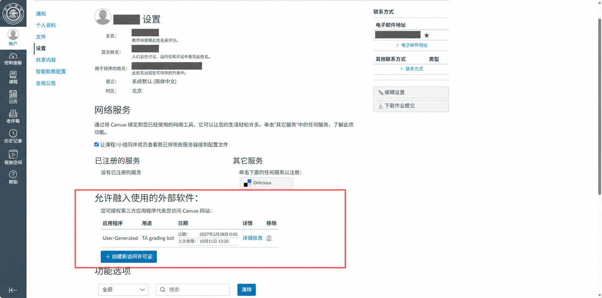
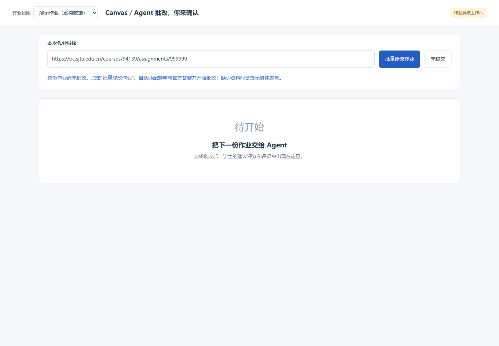
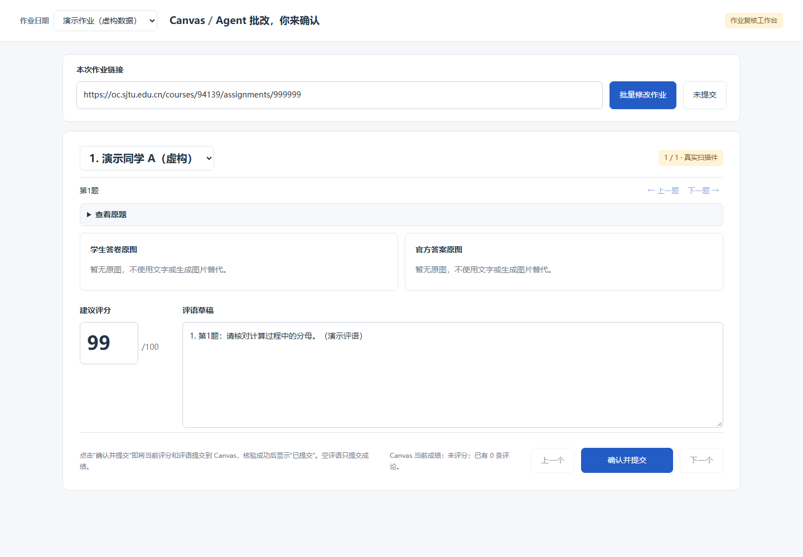
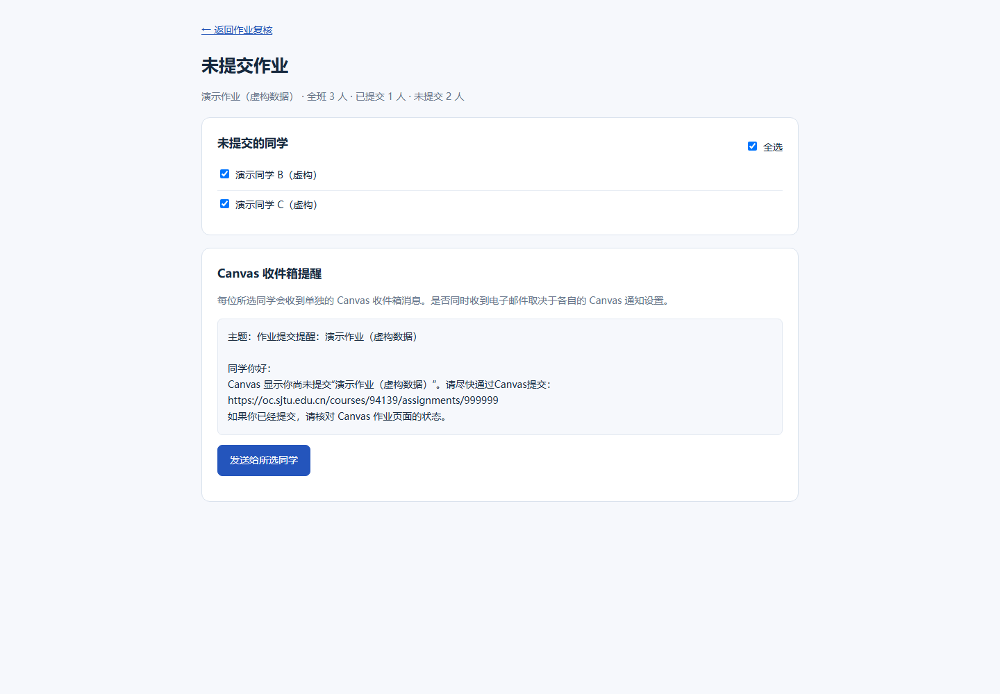

# Canvas 作业批改工作台

面向上海交通大学 Canvas 的本地批改工具：读取学生提交的 PDF / 图片，根据已核验的原题和官方答案生成评分建议，再由教师或助教逐位复核、修改并提交到 Canvas。

**使用流程：配置访问令牌和模型密钥 → 准备题库 → 启动网页 → 选择作业 → 点击“批量修改作业” → 人工复核 → 点击“确认并提交”。**

当前网页默认通过 YXIN 调用双模型进行批改与审查；使用者可选择其他模型 API 服务，由 AI 或维护者完成接入适配。批量批改只生成本地建议；“确认并提交”才会写入当前学生的真实成绩及非空评语。“未提交”页面还可向所选学生发送 Canvas 收件箱提醒。

> 当前是面向特定课程的本机工具，不是开箱即用的多学校、多用户在线平台。交大域名和作业列表课程 `94139` 仍写在代码中；新电脑还需要单独准备题库与官方答案。下面将这些前提与配置步骤一并列出。

## 1. 需要哪些“许可证”？到哪里获取？

**代码没有软件激活码或付费许可证校验。运行所需的是两类访问凭据，以及课程操作权限。**

| 所需项目 | 用途 | 获取位置 |
|---|---|---|
| Canvas 访问令牌 `CANVAS_API_TOKEN` | 读取作业、学生提交和成绩；经人工点击后写入成绩、评论或发送提醒 | 自己的交大 Canvas 账户中生成，步骤见下文 |
| 模型 API 密钥 | 调用批改和审查模型，按所选服务商账户额度计费 | 在自己选择的 API 服务商控制台创建，保存到项目根目录 `.env`；YXIN 只是当前默认接入示例 |
| Canvas 课程权限 | 查看学生答卷、评分和发送课程消息 | 由任课教师或学校 Canvas 管理员为账户授予对应权限；令牌不会提升账户权限 |
| 原题和官方答案资料 | 为模型提供本次作业的依据 | 提供题库和官方答案的网页地址或本地文件路径，交给 AI 整理、建立索引并检查 |

仓库目前没有 `LICENSE` 文件，不能据此宣称采用 MIT、Apache 等开源许可证。若要再分发或商用，需由项目所有者明确授权范围；教材与答案的使用权限也应随资料单独确认。

### 1.1 获取 Canvas 访问许可证 / 令牌（个人本机测试）

1. 用自己的教师或助教账号登录 [交大 Canvas](https://oc.sjtu.edu.cn/)。
2. 打开“账户 → 设置”，找到下图中的“允许融入使用的外部软件”区域（其他版本可能显示“已批准的集成 / Approved Integrations”）。也可从[个人资料入口](https://oc.sjtu.edu.cn/profile)进入设置。
3. 点击“创建新访问许可证”（其他版本可能显示“New Access Token”），填写用途（例如“本机作业批改测试”），按学校要求设置有效期并生成。
4. 立即复制生成的完整令牌，填入项目根目录 `.env` 的 `CANVAS_API_TOKEN`。令牌生成后通常不能再次查看；丢失或过期时重新生成并替换。
5. 若没有令牌入口，联系学校 Canvas 管理员确认是否允许此方式。浏览器已登录并不能代替后端的 API 令牌。

下图为用户提供的 Canvas 设置页面，红框中的“创建新访问许可证”就是入口：



菜单翻译可能随学校部署不同。上述流程依据 [Canvas 官方令牌说明](https://developerdocs.instructure.com/services/canvas/oauth2/file.oauth#manual-token-generation)，截图展示了本校菜单位置；生成令牌需在自己的账户中操作。官方要求供多个用户使用的应用采用 OAuth；当前项目尚未实现 OAuth，不能把“收集其他人的个人令牌”作为多人部署方案。

### 1.2 获取模型 API 密钥（服务商自行选择）

使用者可以自行选择提供图片理解能力、适合批改任务的模型 API 服务。**

1. 在所选服务商的控制台注册或登录，创建 API 密钥，确认账户额度和可用模型。
2. 将 **API 密钥、接口地址（Base URL）和模型名称放在项目根目录 `.env` 中**，不要写进前端页面、源码或 README。
3. 将服务商名称、接口文档地址和希望使用的模型告诉 AI，让 AI 完成接入配置与验证。实际密钥直接填写在本机 `.env`，无需粘贴到对话中。

以当前默认接入的 YXIN 为例，可从 [意心 AI 官网](https://yxai.chat/)进入[管理 API 密钥](https://yxai.chat/console/apikey)，取得密钥后配置到 `.env` 的 `YXIN_API_KEY`。这只是一个示例，不要求使用者购买该服务。

**当前实现边界：**现有网页后端仍对 YXIN 地址和调用方式做了校验，尚未提供通用服务商切换配置。选择其他服务商时，需要 AI 或维护者适配后端的地址校验、请求/响应格式及模型配置，再将对应配置写入 `.env`；仅修改地址并不能保证运行。当前变量名及默认示例见下节，其他变量名应以适配后的代码为准。

默认配置使用 `gpt-5.6-terra` 批改、`gpt-5.6-sol` 审查，运行时会检查模型目录；模型名称、可用性和费用以所选服务商账户为准。批改会将原题、官方答案和学生答卷图片发送给配置的服务商，应确认课程允许其处理这些材料。

## 2. 本机部署（Windows / PowerShell）

### 2.1 获取项目与安装依赖

取得项目代码并解压到自己的目录，例如 `D:\Projects\canvas-homework-grading`。以下命令均在项目根目录执行；路径请替换成自己的实际位置。

安装 Python 3.10 或更高版本（本机检查使用 Python 3.10.9），然后执行：

```powershell
cd D:\Projects\canvas-homework-grading
python --version
python -m venv .venv
.\.venv\Scripts\python.exe -m pip install -r tools/requirements.txt
.\.venv\Scripts\python.exe -m pip install tzdata
```

`tools/requirements.txt` 包含 Pillow（图片处理）和 zxing-cpp（教材二维码解码）。Windows 额外安装 `tzdata`，供 `Asia/Shanghai` 时区读取使用。直接调用虚拟环境的 Python，无需修改 PowerShell 的脚本执行策略。

处理 PDF 还需要 **Poppler 的 `pdfinfo` 和 `pdftoppm`**。Windows 可从 [Poppler Windows 打包项目的 Releases](https://github.com/oschwartz10612/poppler-windows/releases) 下载并解压二进制包，将包含这两个 EXE 的目录（通常为 `Library\bin`）加入用户 `PATH`，然后重新打开 PowerShell。该项目是 Windows 二进制打包来源。

检查依赖：

```powershell
.\.venv\Scripts\python.exe -c "from PIL import Image; from zoneinfo import ZoneInfo; print('图片依赖正常；时区：', ZoneInfo('Asia/Shanghai'))"
pdfinfo -v
pdftoppm -v
```

三条命令均能运行后再继续。只安装 Python 包不会安装 Poppler。

### 2.2 创建配置文件

首次配置时将根目录的 `.env.example` 复制为 `.env`。**已有 `.env` 时直接编辑，避免覆盖现有密钥。**

```powershell
if (-not (Test-Path -LiteralPath .env)) { Copy-Item -LiteralPath .env.example -Destination .env }
notepad .env
```

以下是当前默认 YXIN 接入的 `.env` 示例，将占位文字替换为实际凭据。使用其他 API 时，让 AI 根据所选服务商适配代码并给出对应的 `.env` 配置；所有服务商的密钥都应保存在 `.env` 中：

```dotenv
CANVAS_API_TOKEN=YOUR_CANVAS_API_TOKEN
YXIN_BASE_URL=https://yxai.chat
YXIN_API_KEY=YOUR_YXIN_API_KEY
YXIN_GRADER_56=gpt-5.6-terra
YXIN_REVIEWER_56=gpt-5.6-sol
```

- `.env` 位于项目根目录，和 `README.md` 同级，不放在 `tools/` 中。
- `YXIN_BASE_URL` 当前只接受 `https://yxai.chat` 或 `https://yxai.chat/v1`；不能只换地址就接入其他供应商。
- 示例文件里的 `DASHSCOPE_API_KEY`、`QWEN_BASE_URL` 属于旧 Qwen 接入实验，当前网页不需要填写。
- 系统环境变量优先于 `.env`。更换密钥后仍报旧错误时，检查是否设置过同名环境变量，并重启服务。
- `.env` 已被 Git 忽略，但直接压缩整个文件夹仍可能把它带走，分享前需排除。

### 2.3 准备课程题库和官方答案（首次部署必做）

**使用者只需提供题库和官方答案的地址，让能够访问本项目文件的 AI 助手完成资料整理与建库，无需自己编写 JSON 或计算哈希。** 地址可以是网页/PDF 下载链接，也可以是本地文件或文件夹路径。需要登录的资料，应先在自己有权限的环境中下载，再提供本地路径。

可以直接把下面这段话发给 AI，并替换其中的地址：

> 请为这个项目配置题库。Canvas 课程地址是：〈课程地址〉；题库地址是：〈题库链接或本地路径〉；官方答案地址是：〈答案链接或本地路径〉。请读取资料，按章节和完整大题匹配原题与答案，保留跨页内容和来源，生成本项目要求的 PNG、catalog.json 和文件哈希，并运行索引检查。缺失答案、无法访问或无法确定的对应关系请列出，不要猜测。最后告诉我可批改的章节和题号。

AI 完成后，查看其输出的覆盖范围和缺失项，再打开工作台批改。如果资料地址不可访问或答案不完整，补充地址或文件后让 AI 继续处理。

这里的 AI 整理是部署时由 AI 助手完成的工作，**不是当前网页已有的“粘贴地址自动导入”功能**。仓库不附带教材与官方答案；网页批改仍读取整理后的本地资料。已由维护者建好库的同一课程，也可直接交接现有资料包。

<details>
<summary>供 AI / 维护者参考：本地题库结构与检查方法</summary>

```text
prototypes/
  local/
    reference-library/
      catalog.json       # 已核验的课程、教材、章节、题号、图片路径与 SHA-256
      index.json         # 自动生成，无需手工建立
      ...                # 原题和答案 PNG；也可使用 catalog 指定的其他目录
```

同一课程换电脑时，向课程维护者获取 `catalog.json` 及其引用的全部原题/答案 PNG，按原有相对路径放回 `prototypes/`。只复制 `reference-library/` 不一定够：图片可以位于它以外的目录，必须逐一按 `catalog.json` 中的 `path` 保留位置。不要为此复制其他人的 `.env`、学生答卷或历史成绩。

首次为新教材建库时，可由 AI 整理并核对章节、题号、原题、答案、跨页与来源，再建立映射；无法确定的条目交由使用者确认。下面是**结构示例，不是可直接使用的题库**：

```json
{
  "course_id": "94139",
  "book_id": "your-textbook",
  "book_title": "课程教材名称",
  "assets": {
    "local/reference-library/q1.png": "替换为q1.png的SHA-256小写值",
    "local/reference-library/a1.png": "替换为a1.png的SHA-256小写值"
  },
  "chapters": {
    "1": {
      "title": "习题一",
      "questions": {
        "1": {
          "question_images": [{"path": "local/reference-library/q1.png", "source": "教材习题一第1题，页码待填写"}],
          "answer_images": [{"path": "local/reference-library/a1.png", "source": "官方答案第1题，来源待填写"}]
        }
      }
    }
  }
}
```

`course_id` 必须为字符串，并与作业 URL 的课程 ID 一致。图片路径相对于 `prototypes/`，当前读取函数要求本地 PNG；跨页题目在对应数组中添加全部相关图片。图片核验后可用以下命令计算哈希：

```powershell
(Get-FileHash -LiteralPath prototypes/local/reference-library/q1.png -Algorithm SHA256).Hash.ToLowerInvariant()
```

准备好后，在项目根目录运行本地索引检查（不访问 Canvas、不调用模型）：

```powershell
.\.venv\Scripts\python.exe -c "import sys; sys.path.insert(0, 'tools'); from reference_index import build_reference_index; x=build_reference_index('prototypes'); print([(c, n, q['problems']) for c, s in x['chapters'].items() for n, q in s['questions'].items() if q['problems']])"
```

输出 `[]` 表示已登记条目没有发现缺图或哈希问题，不代表内容已由程序验证正确。列出错误时按对应题号补齐资料；尚未登记的题号会在批改时提示缺失。图片替换后需重新人工核验并更新哈希。

Canvas 作业说明必须明确写完整大题，例如 `习题一：21、23、25、26` 或 `课本习题一: 1, 2, 6-8`。混合多章、仅部分小问、排除题目或附加不符合格式的说明，当前解析器会拒绝；不会猜测题号。匹配失败会在下载学生答卷及调用模型之前停止。

</details>

### 2.4 换课程或学校前须知

| 配置点 | 当前实现 | 更换时需要处理 |
|---|---|---|
| 作业下拉框 | `tools/assignment_store.py` 的 `assignment_catalog()` 固定读取课程 `94139` | 修改其中的课程 API 路径与生成的作业 URL；目前没有 `COURSE_ID` 环境变量 |
| 题库 | `catalog.json` 对应一个课程和教材 | 为目标课程提供匹配的题库，不能只改课程 ID 冒用旧教材 |
| Canvas 站点 | `tools/canvas_roster.py` 固定交大域名；`tools/canvas_batch.py` 校验交大附件和文件服务域名 | 其他学校需开发适配并验证，不能只替换网页链接 |
| 学科与评分 | 提示词面向概率论，课程规则写在 Python 中 | 不同学科或扣分规则需要修改并验证；不是网页配置项 |

手动输入其他交大课程链接不等于完成课程适配：题库课程校验仍会执行，下拉列表也不会因此改为新课程。

### 2.5 启动与关闭

首次运行建议使用前台模式，便于看到错误：

```powershell
.\.venv\Scripts\python.exe tools/serve.py --port 8767
```

保持此窗口打开，在浏览器访问 **[作业复核工作台](http://127.0.0.1:8767/review-workbench.html)**。关闭服务时回到该终端按 `Ctrl+C`。

也可使用项目内启动器，后台启动并自动打开浏览器：

```powershell
.\.venv\Scripts\python.exe tools/launch_webui.py
```

启动器固定使用 8767 端口，日志在 `prototypes/local/webui.log`。关闭浏览器不会停止后台服务；需在任务管理器中确认对应本项目的 Python 服务进程后结束。原开发机的 `canvas webui` 是本机快捷命令，仓库未提供其全局安装步骤，新电脑请使用上面的 Python 命令。

**不要双击 HTML 或用纯静态服务器运行正式批改。** 正式页面需要 `tools/serve.py` 提供 API。服务仅监听 `127.0.0.1`，没有多用户登录与公网部署支持，不应直接当作线上服务发布。

## 3. 如何使用：从点击批改到提交成绩

本节三张操作截图来自当前 HTML/JS 页面配合隔离的虚构 API 数据，不含真实学生信息，也没有调用模型、写入 Canvas 或发送提醒。截图只解释按钮位置，不作为真实批改成功的证据。

### 第一步：选择作业，点击批改

1. 在左上角“作业日期”下拉框中选作业；它显示 Canvas 作业名称，也可以手动填写本次作业链接。
2. 链接应为 `https://oc.sjtu.edu.cn/courses/课程ID/assignments/作业ID`，不要填课程首页、SpeedGrader 地址或带查询参数的链接。
3. 确认作业正确后，点击蓝色 **“批量修改作业”**。
4. 等待页面完成“匹配题库 → 下载全部已交附件 → 批改 → 审查”。按钮运行中会禁用，耗时取决于人数、页数和模型响应。



这个按钮的名称虽然包含“修改”，但此阶段生成的是本地评分和评语建议，不会批量提交成绩。已有结果会随作业切换加载；再次点击时，未变化的答卷与配置可复用，新提交、重新提交或原题/模型/规则变化会触发重新批改。

### 第二步：逐位复核、改分和改评语

1. 用学生下拉框或底部“上一个 / 下一个”切换学生。
2. 用“上一题 / 下一题”查看错误和待核对项；“查看原题”展开原题，答卷和答案图片可点击放大。通常正确题不逐题展示。
3. 检查建议评分，直接修改分数和“评语草稿”。读不清、疑似错章节、模型分歧等仍需人工处理。
4. 确认当前学生、分数和评语无误，再点 **“确认并提交”**。



当前规则：100 分起，每道确认错误的大题扣 1 分；迟交按 `ceil(seconds_late / 86400)` 计天，每天再扣 0.5 分，总分最低 95 分。待核对题不自动扣分；提交不匹配或迟交信息异常时可能不给建议分。人工仍可输入最终成绩；写回仅支持满分 100 的普通个人计分作业。

### 第三步：确认提交成功

“确认并提交”仅处理当前学生：写入分数与非空评语，再回读 Canvas，核验成功后显示 **“已提交”**。切到下一位不会自动提交上一位。

- 空评语只更新分数，不删除已有评论；修改评语后再次提交会新增评论，不是编辑旧评论。
- 他人改过分数/评论，或学生重新提交，程序会要求重新核对，避免覆盖已变化的内容。
- 状态不明、断网或报错时先到 Canvas 核验，不要反复点击；程序保存了提交账本供恢复判断。
- 首次实际使用时，先完成一位学生的人工复核提交，再进入 Canvas 对照分数和评论。学生能否立即看到成绩由 Canvas 发布策略决定。

写回与回读逻辑已有自动化测试；现有验收记录尚未确认真实写入权限与真实页面保存效果。本次 README 更新也未执行真实提交。详见[人工复核提交说明](docs/09-canvas-review-submit.md)。

### 第四步：给未提交学生发送提醒（可选）

点击作业链接旁的 **“未提交”**，核对实时名单。页面默认全选；取消不需要提醒的学生，检查预览后点击 **“发送给所选同学”**。



发送前会再次检查提交情况，只向仍未提交且未免交的学生发各自独立的 Canvas 收件箱消息。文案不额外设截止期限；当前页面没有自定义消息或提醒日期入口。Canvas 消息成功不等于电子邮件已经送达，邮件通知取决于学生设置。

## 4. 常见问题

| 现象 | 检查与处理 |
|---|---|
| `python` 无法运行 | 安装 Python 并重新打开终端；后续使用项目虚拟环境的 Python |
| `No module named PIL` / 找不到时区 | 在实际运行服务的虚拟环境安装依赖和 `tzdata` |
| PDF 无法完整渲染 | 在启动服务的终端检查 `pdfinfo -v`、`pdftoppm -v`；PDF 需为 1–40 页 |
| 配置 Canvas token 后仍无权限 | 检查过期、同名环境变量及课程权限；浏览器登录与 API token 是两回事 |
| 作业下拉框显示旧课程 | 课程 `94139` 当前写在代码中，按“换课程”一节处理；读取失败时也可能显示缓存列表 |
| 本机尚未收录题库 / 缺少官方答案 | 获取完整资料包，检查 `catalog.json`、PNG 路径、课程 ID 与哈希 |
| 无法明确识别作业章节和题号 | 按支持格式核对 Canvas 作业说明，不能只写题号或混合章节 |
| YXIN 密钥或模型目录错误 | 检查账户密钥、额度、网络及两个模型 ID 的实际可用性 |
| HTTP 403 / 错误码 `10065` | 查看 `prototypes/local/yxin-runs/<run-id>/usage.json`；请求大小与失败细节见[诊断说明](docs/08-yxin-request-size-diagnosis.md)，不要持续重复整批点击 |
| 附件类型不支持 | 当前支持 Canvas 在线上传的 PDF、JPEG、PNG，单附件不超过 30 MiB；Word、压缩包、纯文本提交需要另行处理 |
| 端口被占用 | 检查是否已有本项目服务；或改用 `--port 8768` 并访问相应端口，自动启动器仍固定为 8767 |
| “暂不能提交”或提交状态未知 | 看页面提示，先到 Canvas 核对成绩/评论及新提交版本，再处理本机账本 |

模型调用失败会保留旧展示结果；已完成双阶段处理的学生可在匹配相同提交与配置时复用。网络超时不会自动重试；特定上游错误才有有限重试，详情见 [YXIN 接入说明](docs/07-yxin-dual-model.md)。

## 5. 数据保存、迁移与分享

| 位置 | 内容 |
|---|---|
| `.env` | 本机访问令牌及 API 密钥 |
| `prototypes/local/reference-library/` | 题库目录及可重建索引，图片以实际引用路径为准 |
| `prototypes/local/assignments/<课程ID>-<作业ID>/` | 各份作业的 `batch-source.json` 与 `batch-review.json` |
| `prototypes/local/` 的其他运行子目录 | 下载附件、渲染页面、证据截图与历史结果；路径以批次 JSON 为准 |
| `prototypes/local/yxin-runs/` | 模型调用记录、用量与 `partial-result.json` |
| `prototypes/local/review-submissions/` | 成绩/评论提交账本 |
| `prototypes/local/reminder-ledger/` | 提醒发送账本 |
| 浏览器本地存储 | 人工评分/评语草稿、作业选择与阅读位置 |

草稿依赖同一浏览器及同一站点地址；更换端口、浏览器或从 `127.0.0.1` 改成 `localhost`，不会自动迁移。不要把服务端文件备份当成浏览器草稿备份。迁移自己已使用的环境时，应妥善保留提交/提醒账本，避免丢失历史发送状态。

对外分享代码时排除 `.env`、`.venv/`、`prototypes/local/`、`outputs/` 及真实学生资料。题库通过授权的资料包单独交接。操作流程的三张截图仅含虚构数据。许可证小节使用用户提供的真实账户设置截图，其中含个人资料；对外公开前请按需要脱敏。

## 6. 开发验证与文档导航

本地测试（使用模拟数据/API，不代表真实模型准确率或 Canvas 写入验收）：

```powershell
.\.venv\Scripts\python.exe -m unittest discover -s tests -v
# 前端逻辑测试另需可运行 node --test 的 Node.js；日常使用网页不需要 Node.js
node --test tests/test_review_ui.cjs
```

| 文档 | 内容 |
|---|---|
| [流程设计](docs/01-workflow-design.md) | 附件读取、建议、写回与完成条件 |
| [课程评分策略](docs/02-course-policy.md) | 评分规则与课程约定 |
| [运行记录与恢复](docs/03-run-record.md) | 提交版本、逐题证据、重复运行与人工修改保护 |
| [历史验证记录](docs/04-validation.md) | 早期只读演练与模拟结果，不代表当前完整产品验收 |
| [辅助工具](docs/05-supporting-tools.md) | 教材二维码解码和独立虚构数据演练台 |
| [YXIN 接入说明](docs/07-yxin-dual-model.md) | 双模型、调用记录与断点复用 |
| [请求大小诊断](docs/08-yxin-request-size-diagnosis.md) | 模型失败日志与图片请求大小 |
| [人工复核提交](docs/09-canvas-review-submit.md) | 成绩和评论写回、回读、冲突与幂等处理 |

部分专题文档保留早期开发记录；当前部署入口、题库自动匹配和页面按钮以本 README 及当前代码为准。旧 Qwen 文档不适用于当前网页的默认调用链。
